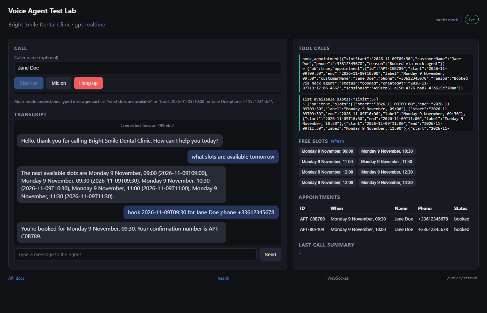
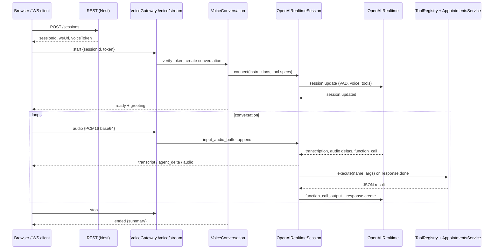

# Realtime Voice Agent

[](https://github.com/MohamedAliTrabelsiSE/realtime-voice-agent/actions/workflows/ci.yml)

A real-time **AI voice receptionist** backend. A caller talks in the browser (or any WebSocket client), the audio streams through a **NestJS** service to the **OpenAI Realtime API** (speech-to-speech), and the model books, finds and cancels appointments by calling **typed backend tools**.

It ships with a **mock realtime mode**, so the whole stack (test lab, unit tests, e2e tests) runs offline without an API key.



## Features

- **Low-latency voice loop**: microphone PCM goes to OpenAI Realtime over WebSocket, and spoken audio streams back chunk by chunk (no waiting for the full reply).
- **Barge-in**: server-side voice activity detection; when the caller starts talking, the client is told to stop playback and the model cancels its answer.
- **Function calling with validation**: each tool is declared once with a `zod` schema, which is published to the model as JSON Schema *and* used to validate the arguments the model sends back. Domain errors are returned to the model as structured `{ ok: false, code, error }` so it can recover ("that slot was just taken, how about 10:30?").
- **Safe tool-call sequencing**: tool calls are collected during a response and executed on `response.done`, avoiding the "conversation already has an active response" race.
- **Session auth**: `POST /sessions` issues a short-lived HMAC token bound to one session; the WebSocket must present it, and a session can only be used once.
- **Audio normalisation**: accepts PCM16 at any sample rate or WAV (any channel count), and downmixes and resamples to the model rate.
- **Transcripts and call summary**: every turn and tool call is recorded; `GET /sessions/:id` returns the full call.
- **Browser test lab** at `/`: mic capture with an AudioWorklet, streamed playback, live transcript, tool-call log, free slots and the appointments table.
- **Swagger** at `/docs`, Docker image, GitHub Actions CI, about 99% unit test coverage plus e2e tests.

## Architecture



```
src/
  audio/          PCM16 / WAV helpers (resample, downmix, encode/decode)
  auth/           HMAC voice tokens
  appointments/   booking engine, tools exposed to the model, REST controller
  config/         zod-validated env config, injectable clock
  prompts/        receptionist instructions and greeting
  realtime/       OpenAI Realtime client, mock client, factory
  sessions/       session store and REST endpoints
  tools/          generic zod-backed tool registry
  voice/          WebSocket gateway, per-call orchestration, wire protocol
public/           browser test lab (vanilla JS + AudioWorklet)
test/             e2e tests (mock mode and a scripted fake OpenAI upstream)
```

Design notes:

- **Testability seam**: `OpenAIRealtimeSession` takes a socket factory. Unit tests drive it with an in-process fake; the e2e suite swaps the Nest provider for a scripted fake OpenAI server, so the real protocol code path is tested end to end without the network.
- **Time is injected** (`CLOCK` provider), so slot availability, token expiry and call durations are deterministic in tests.
- **Slots are naive local times** (`YYYY-MM-DDTHH:mm`) in the business timezone. They sort lexicographically and need no timezone library.
- Storage is in-memory by design. `SessionStore` and `AppointmentsService` are the seams to swap for Redis or Postgres.

## Quick start

Requires Node.js 20 or later.

```bash
npm install
cp .env.example .env      # optional
npm run start:dev
```

Open <http://localhost:3000>, click **Start call**, then type, for example:

- `what slots are available`
- click a slot chip, which fills in `book 2026-01-05T10:00 for Jane Doe phone +15551234567`, then press **Send**
- `find APT-XXXXXX` or `cancel APT-XXXXXX`

### Real voice mode

Set `OPENAI_API_KEY` in `.env` and restart. The lab then shows `mode: openai`. Click **Mic on** and just talk, for example: *"Hi, I'd like a check-up tomorrow morning."*

### Docker

```bash
docker compose up --build
```

## Configuration

All variables are optional; see [`.env.example`](.env.example).

| Variable | Default | Notes |
| --- | --- | --- |
| `OPENAI_API_KEY` | empty | Empty means mock mode |
| `MOCK_REALTIME` | auto | Force mock mode (`true`) or require OpenAI (`false`) |
| `REALTIME_MODEL` / `REALTIME_VOICE` | `gpt-realtime` / `marin` | |
| `NOISE_REDUCTION` | `near_field` | `near_field`, `far_field` or `none` |
| `VAD_THRESHOLD`, `VAD_SILENCE_MS` | `0.5`, `500` | Turn-taking sensitivity |
| `VOICE_TOKEN_SECRET` | dev secret | **Required** when `NODE_ENV=production` |
| `BUSINESS_NAME`, `BUSINESS_TIMEZONE` | demo clinic, `Europe/Paris` | |
| `OPENING_HOUR`, `CLOSING_HOUR`, `SLOT_MINUTES` | `9`, `17`, `30` | Monday to Friday |

## HTTP API

| Method | Path | Description |
| --- | --- | --- |
| `POST` | `/sessions` | Create a call session; returns `sessionId`, `wsUrl`, `voiceToken` |
| `GET` | `/sessions` / `/sessions/:id` | Call summaries / full transcript and tool calls |
| `GET` | `/appointments` | All appointments |
| `GET` | `/appointments/slots?date=YYYY-MM-DD&limit=N` | Free slots |
| `GET` | `/health` | Status and realtime mode |
| `GET` | `/docs` | Swagger UI |

## WebSocket protocol (`/voice/stream`)

Every frame is JSON: `{ "event": string, "data": object }`.

**Client to server**

| Event | Data |
| --- | --- |
| `start` | `{ sessionId, token }`, which must be sent first |
| `audio` | `{ audio: base64, format?: "pcm16" \| "wav", sampleRate?: number }` (mono PCM16, ~100 ms frames) |
| `text` | `{ text }`, a typed user message |
| `interrupt` | `{}`, cancels the current spoken reply |
| `stop` | `{}`, hangs up and returns a summary |
| `ping` | `{}` |

**Server to client**

| Event | Data |
| --- | --- |
| `ready` | `{ sessionId, realtimeMode, sampleRate }` |
| `transcript` | `{ role: "user" \| "assistant", text }`, final text of a turn |
| `agent_delta` | `{ text }`, streaming assistant text |
| `audio` | `{ audio: base64 PCM16, sampleRate }`, play in order |
| `speech_started` | `{}`, the caller is talking, so stop playback |
| `tool_call` | `{ name, args, ok, result }` |
| `ended` | `{ summary: { durationMs, userTurns, toolCalls, bookedAppointmentIds, ... } }` |
| `error` | `{ code, message }` |
| `pong` | `{ at }` |

## Testing

```bash
npm test            # unit tests
npm run test:cov    # unit tests + coverage thresholds (90% lines)
npm run test:e2e    # boots the Nest app on a random port, drives it over HTTP + WebSocket
npm run lint && npm run typecheck
```

The e2e suites cover:

1. **Mock mode**: create a session, connect, greet, book via text, verify through `GET /appointments`, hang up, and check the stored transcript and summary. They also stream microphone audio, check that double booking is rejected, and that tampered tokens and session replay are refused.
2. **OpenAI protocol**: the real `OpenAIRealtimeSession` against a scripted fake upstream. It covers the handshake and `session.update` contents, greeting, audio append, speech transcription, the `book_appointment` function call and `function_call_output` round trip, the spoken confirmation, and an upstream disconnect.

## License

MIT
